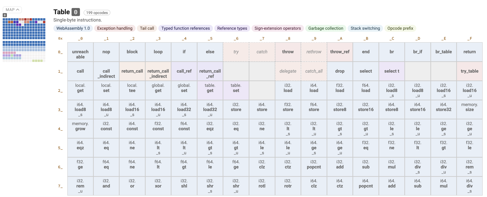
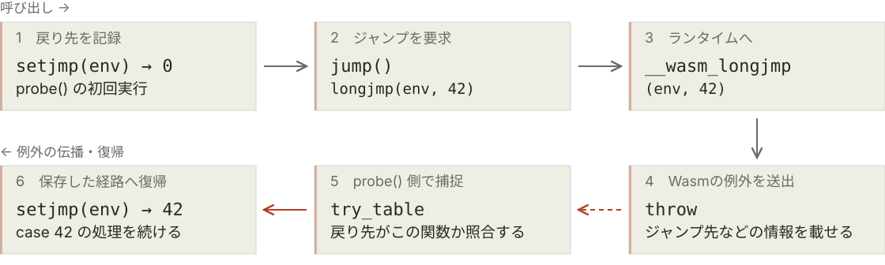
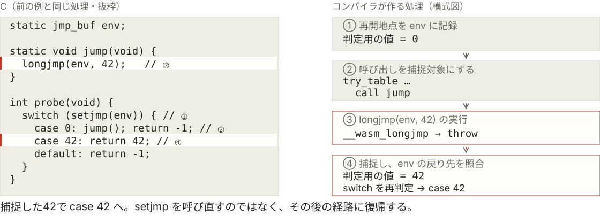

<!-- _class: hero -->

# 入門 Wasmの例外命令

Legacy EHと、新しい例外命令

Fukuoka.wasm #1

<!--
目安 0:00–0:15（15秒）。本編32枚、合計15分。参考資料2枚は時間外。
タイトルとイベント表記は仮。開催日や所属などは未記入。
今日は言語の例外がWasmでどう動くか、生成された命令から見ていきます。
-->

---

<!-- _class: profile -->

<style scoped>
.bio-layout { display:grid; grid-template-columns:260px 1fr; gap:56px; align-items:center; margin:16px 0 24px; }
.bio-photo { display:block; width:260px; height:260px; object-fit:cover; border:1px solid var(--line); border-radius:50%; }
.bio-name { margin:0 0 6px; font-size:36px; font-weight:650; line-height:1.3; }
.bio-handle { margin:0 0 20px; font-size:23px; color:var(--accent); }
.bio-details { margin:0; padding-left:1.2em; font-size:25px; }
.bio-details li { margin:8px 0; }
</style>

# 自己紹介

<div class="bio-layout">
  
  <div>
    <p class="bio-name">近藤うちお / Uchio Kondo</p>
    <p class="bio-handle"><a href="https://github.com/udzura">@udzura</a></p>
    <ul class="bio-details">
      <li>株式会社SmartHR プロダクトエンジニア</li>
      <li>Fukuoka.rb / Fukuoka.wasm</li>
      <li>エンジニアカフェ ハッカーサポーター</li>
      <li>Ruby / mruby / Rust / Wasm</li>
    </ul>
  </div>
</div>

<!--
0:15–0:45（30秒）。所属とコミュニティ、Ruby/Rust/Wasmに触れていることを短く紹介する。
プロフィールと写真はcloudflare-workers-in-fukuoka-2/index.mdの自己紹介から再利用。
-->

---

# きっかけ： `mix of legacy and new...`

```text
CompileError: WebAssembly.instantiate():
module uses a mix of legacy and new
exception handling instructions
```

Rust + Emscripten + C の組み合わせで発生

「例外の命令に、新旧がある……？」

<!--
0:45–1:10（25秒）。mruby-jsonrsをEmscripten向けにリンクした際に遭遇した問題が調査のきっかけ（発表者の体験）。
まずエラーを見せ、最後にmruby-jsonrsの構成を説明してここへ戻る。表示したエラーは最小再現でも確認したもの。
実測: ../wasm-exception-research/results/c-main-prebuilt-run.txt
-->

---

# 今日見るもの

1. Wasmの例外の概要
2. WATで書いてみる
3. C++での最小例
4. Cの `setjmp/longjmp`
5. 新旧例外が混ざる時

<!--
1:10–1:25（15秒）。WATはWasmのテキスト表現。読めなくても、値を積む・投げる・捕まえるの順で追えば大丈夫と伝える。
-->

---

<!-- _class: hero -->

# Wasmの例外の概要

<!--
1:25–1:30（5秒）。まずWasm EHの基本と、新旧の命令の経緯を紹介する。
-->

---

# Wasmにも例外処理の命令がある

- EH = Exception Handling
- 例外は「タグ」と「値の組」で表される
- 投げると、呼び出し元をたどってハンドラを探す
- C++の例外や、Cの非局所ジャンプの実装に使える

メモリ範囲外アクセスなどの trap とは別の仕組み

<!--
1:30–1:55（25秒）。タグは例外を区別するための識別子で、ペイロードの型も定める。
Wasm内のcatchではtrapを捕捉しない。JS側からRuntimeErrorをcatchできることと区別する。
出典: https://github.com/WebAssembly/spec/blob/main/proposals/exception-handling/Exceptions.md
-->

---

# Wasmの例外命令には新旧がある

| 方式 | どう実現するか |
| --- | --- |
| Wasm Legacy EH | `try` / `catch` / `rethrow` |
| 標準のWasm EH | `try_table` / `throw_ref` |

今日比較するのは、この二つの方式

<!--
1:55–2:40（45秒）。Legacy EHと標準のEHで、使う命令が異なることを示す。
throw命令は新旧で共通。表は方式を見分ける主な命令だけを示している。
出典: https://emscripten.org/docs/porting/exceptions.html
出典: https://github.com/WebAssembly/exception-handling/blob/main/proposals/exception-handling/legacy/Exceptions.md
-->

---

# 新方式では、例外そのものを値として扱う

- 2023年10月：`exnref` を使う方式への変更に合意
- `try_table`：捕捉する例外と分岐先を並べる
- `exnref`：捕捉した例外への参照
- `throw_ref`：その参照を使って再送出する

現在のWebAssembly 3.0仕様には新方式が載っている

<!--
2:40–3:20（40秒）。Legacyはcatchのスコープを指定してrethrowする。
新方式は例外への参照を受け取り、元のcatchの構造に縛られず再送出できる。単なる名前変更ではない。
2023年10月は設計変更の合意時期であり、全ブラウザでの実装完了時期ではない。
出典: https://github.com/WebAssembly/meetings/blob/main/main/2023/CG-10.md#exception-handling-vote-on-proposal-to-re-introduce-exnref
出典: https://webassembly.github.io/spec/core/syntax/instructions.html#control-instructions
-->

---

<!-- _class: hero -->

# WATで書いてみる

<!--
3:20–3:25（5秒）。新旧の命令を小さなWATで見比べるパートへ。
-->

---

<!-- _class: small-code -->

# まずはWAT：Legacyで42を投げる

```wat
(module
  (tag $error (param i32))
  (func (export "answer") (result i32)
    try (result i32)
      i32.const 42
      throw $error
    catch $error
      ;; スタック上に42が来る
    end))
```

`throw` で投げ、タグが一致する `catch` で受け取る

<!--
3:25–4:00（35秒）。i32.constはスタックに整数を積む。throwがその値を例外のペイロードにする。
catch後には同じ値がスタックにあり、そのまま関数の戻り値になる。
検証済みのソース: ../wasm-exception-research/src/legacy.wat
-->

---

<!-- _class: small-code -->

# 新方式：捕まえたらラベルへ分岐する

```wat
(module
  (tag $error (param i32))
  (func (export "answer") (result i32)
    block $caught (result i32)
      try_table (catch $error $caught)
        i32.const 42
        throw $error
      end
      unreachable
    end))
```

`$caught` のブロックを抜け、42を結果として受け取る

<!--
4:00–4:35（35秒）。catch節はtry_tableの先頭に移った。捕捉後にブロックの末尾を抜けることを指で追う。
unreachableは通常経路用。この例ではthrowして捕捉されるので実行されない。
新方式のcatchは独立した旧catch命令ではなく、try_tableの即値に含まれる節。
検証済みのソース: ../wasm-exception-research/src/standard.wat
-->

---

<!-- _class: opcode-chart -->

<style scoped>
h1 { margin-bottom: 16px; }
figure { margin: 0; }
figure img { display: block; width: 960px; margin: 0 auto; }
figcaption { margin-top: 12px; font-size: 20px; line-height: 1.5; }
</style>

# 命令表にも、新旧の例外命令が並ぶ

<figure>
  
  <figcaption>
    共通の <code>throw</code> は 0x08 ／ 新方式の <code>throw_ref</code> は 0x0A、<code>try_table</code> は 0x1F<br />
    出典：<a href="https://wasm-chart.pengowray.com/">WebAssembly Opcode Table — Pengo Wray</a>（スクリーンショット）
  </figcaption>
</figure>

<!--
4:35–4:55（20秒）。WATの新旧を見比べたところで、バイトコードにも別々の命令があることを確認。
図の上2段を指し、try/catch/rethrowとthrow_ref/try_tableの位置を見る。throwは共通。
画像は提供されたスクリーンショットをそのまま掲載。サイトの現在の表示とは命令数などが異なる場合がある。
出典: https://wasm-chart.pengowray.com/
-->

---

# 実際に動かすと、どちらも42

```sh
wasm-tools parse standard.wat -o standard.wasm
```

```js
const bytes = fs.readFileSync("standard.wasm");
const wasmModule = new WebAssembly.Module(bytes);
const instance = new WebAssembly.Instance(wasmModule);
console.log(instance.exports.answer()); // 42
```

Node.js 26.8.1で、新旧両方の動作を確認

<!--
4:55–5:25（30秒）。JSは説明用の抜粋。fsのimportなどは省略。
デモする場合は調査ディレクトリで以下を実行すればよい。時間がなければ結果だけ。
wasm-tools parse src/standard.wat -o build/wat-standard.wasm
node src/check-wat.cjs build/wat-standard.wasm
同様にlegacy.watもanswer=42。全ランタイムで検証したわけではない。
-->

---

# 再送出には例外参照を使う

```wat
block $saved (result exnref)
  try_table (catch_all_ref $saved)
    i32.const 42
    throw $error
  end
  unreachable
end
throw_ref
```

内側の `try_table` を抜けた後でも、同じ例外を投げ直せる

<!--
5:25–6:10（45秒）。検証済みrethrow.watの内側だけを抜粋。外側のハンドラがこれを捕まえて42を返す。
catchではペイロードだけ、catch_refではペイロードと例外参照を受け取る。
catch_all_refはタグを問わず例外参照を受け取る。trapまで捕まえるという意味ではない。
ソース: ../wasm-exception-research/src/rethrow.wat
-->

---

<!-- _class: hero -->

# C++での最小例

<!--
6:10–6:15（5秒）。C++の最小コードからem++の生成命令を見る。
-->

---

# C++の例外をコンパイルする

```cpp
extern void may_throw();
int catch_only() {
  try {
    may_throw();
    return 0;
  } catch (...) {
    return 42;
  }
}
```

まずはリンクせず、関数一つの `.o` を見る

<!--
6:15–6:45（30秒）。ランタイム全体をリンクすると命令が増えて追いづらいので、オブジェクトで読む。
may_throwの定義は不要。これは単独実行できるプログラムではなく、生成命令を調べる例。
ソース: ../wasm-exception-research/src/catch-only.cpp
-->

---

# Emscriptenで新旧を選ぶ

```sh
# Legacy
em++ -O1 -fwasm-exceptions \
  -sWASM_LEGACY_EXCEPTIONS=1 \
  -c catch-only.cpp -o legacy.o

# 標準
em++ -O1 -fwasm-exceptions \
  -sWASM_LEGACY_EXCEPTIONS=0 \
  -c catch-only.cpp -o standard.o
```

手元のEmscripten 6.0.9では、既定はまだLegacy

<!--
6:45–7:25（40秒）。同じC++を、例外形式だけ変えて二つの.oにする。
-fwasm-exceptionsでWasm EHを使い、別の設定で新旧を選ぶ。
通常のプロジェクトではコンパイルとリンクの両方に設定する。
出典: https://emscripten.org/docs/tools_reference/settings_reference.html#wasm-legacy-exceptions
ローカル設定: ../wasm-exception-research/results/local-default-setting.txt
-->

---

<!-- _class: small-code -->

# Legacy：try / catch が生成される

```wat
try
  call 0 <env._Z9may_throwv>
  i32.const 0
  ...
catch 0
  ...
  i32.const 42
  ...
end
```

`try` 内で呼び出し、`catch` から捕捉後の処理が続く

<!--
7:25–7:45（20秒）。em++ -O1のlegacy.oをwasm-objdump -dで読んだ抜粋。完全なWATではない。
ローカル変数・スタックポインタの操作、C++ランタイムの呼び出しなどを...で省略。
call先の_Z9may_throwvはC++で名前修飾されたmay_throw。catch 0は例外タグのインデックス。
命令のバイトはtry=0x06、catch=0x07。手書きLegacy WATと同じ構造が生成される。
再現: sh ../wasm-exception-research/compare-cpp-eh.sh
実測: ../wasm-exception-research/results/catch-legacy-disassembly.txt
-->

---

<!-- _class: small-code -->

# 新方式：try_table と block が生成される

```wat
block
  block i32
    try_table catch 0 0
      call 0 <env._Z9may_throwv>
      ...  ;; 通常経路では br 2
    end
    unreachable
  end
  ...      ;; ここから捕捉後の処理
  i32.const 42
end
```

捕捉すると内側の `block` を抜け、後続の処理へ

<small>補足：<code>__cxa_begin_catch</code> などは、C++の例外を管理する補助関数</small>

<!--
7:45–8:05（20秒）。em++ -O1のstandard.oをwasm-objdump -dで読んだ抜粋。完全なWATではない。
try_table catch 0 0は「タグ0を捕捉し、try_tableの外側で深さ0のラベルへ分岐」。この例では内側のblockを抜ける。
通常経路のi32.const 0、local.set、br 2などと、捕捉後のスタックポインタ復元・ローカル変数操作を省略している。
末尾のlocal.setも省略。i32.const 42の値は実際にはローカル変数に保存し、外側のblockを抜けて関数結果として返す。
手書きの新方式WATと同じく、捕捉先の処理がtry_tableの外に置かれることを強調。
新旧とも__cxa_begin_catch / __cxa_end_catchを呼ぶ。ここは一言だけ触れ、命令の違いに集中する。
このcatch-only例は投げる側を含まないので、throw_refが生成される例ではない。
実測: ../wasm-exception-research/results/catch-standard-disassembly.txt
-->

---

<!-- _class: hero -->

# Cの `setjmp/longjmp`

<!--
8:05–8:10（5秒）。Cの非局所ジャンプにもWasm EHが使われることを見る。
-->

---

# Cにはtry/catchがないけれど

```c
static jmp_buf env;

__attribute__((noinline)) static void jump(void) {
  longjmp(env, 42);
}

int probe(void) {
  switch (setjmp(env)) {
    case 0: jump(); return -1;
    case 42: return 42;
    default: return -1;
  }
}
```

<!--
8:10–8:50（40秒）。ヘッダ#include <setjmp.h>とmainは省略。
setjmpは初回0を返す。jumpの中のlongjmpで戻ってくると42を返す。
C規格の呼び出し位置の制約に合わせ、setjmpをswitchの制御式に置いている。
ソース: ../wasm-exception-research/src/sjlj.c
-->

---

# setjmp/longjmpにもWasm EHを使える

```sh
emcc -O1 -sSUPPORT_LONGJMP=wasm \
  -sWASM_LEGACY_EXCEPTIONS=0 \
  sjlj.c -o standard.js
```

| 箇所 | 生成されるもの |
| --- | --- |
| `setjmp` を使う関数 | `try_table` とジャンプ先の判定処理 |
| `longjmp` | `__wasm_longjmp` の呼び出し |
| `__wasm_longjmp` の中 | `throw` 命令 |

<!--
8:50–9:35（45秒）。Cの例外構文を変換しているのではなく、非局所ジャンプの実装にEHを使っている。
-sWASM_LEGACY_EXCEPTIONS=0だけではSjLj方式は変わらない。SUPPORT_LONGJMP=wasmが必要。
出典: https://emscripten.org/docs/porting/setjmp-longjmp.html
実測: ../wasm-exception-research/results/standard-disassembly.txt
-->

---

# CとWasmの対応①：初回は0

<div class="sjlj-diagram"></div>

<!--
9:35–9:55（20秒）。Cの①setjmpと②case 0/jump()を、右の①②と対応づけて説明する。
ホバーすると左右の同じ番号を同時に強調できる。最初から①②を明るくして初回経路を示す。
初回は__wasm_setjmpでenvに再開地点を記録し、判定に使うローカル値を0にする。setjmpというWasm命令はない。
setjmpがソース上の範囲を囲むわけではなく、コンパイラがこの例のjump()呼び出しをtry_tableで捕捉できるようにする。
右はローカル変数操作などを省略した処理の模式図で、実行可能なWATではない。
Cのヘッダとnoinline属性は省略。static jmp_buf envは両関数で共有する戻り先の情報。case 0のreturn -1は、jumpがlongjmpするこの例では実行されない。
実測: ../wasm-exception-research/results/standard-wat.txt のprobe
-->

---

# CとWasmの対応②：捕捉後は42

<div class="sjlj-diagram"></div>

<!--
9:55–10:15（20秒）。同じCコードを置いたまま、③longjmpと④case 42を明るくする。
longjmpは__wasm_longjmpを呼ぶ。その中でenvと42を保持する情報を用意し、Cのlongjmp用タグでthrowする。
例外のペイロードは整数42そのものではなく、その情報を指すポインタ。この実測のタグのペイロード型はi32が一つ。
try_tableが捕捉するとブロックの後ろの処理へ分岐し、envから復帰先がこの呼び出しかを__wasm_setjmp_testで確認する。
一致した場合は42を判定用ローカル変数へ入れ、再開用のloopへbrする。setjmpを呼び直さず、switchの判定を再び行う。
これによりCからはsetjmpが42を返したように見え、case 42のreturn 42へ進む。throwが直接probeの戻り値になるわけではない。
別の呼び出しのenvならさらに伝播させる処理があるが、この図では省略する。
実測: ../wasm-exception-research/results/standard-wat.txt のprobe、jump、__wasm_longjmp
出典: https://emscripten.org/docs/porting/setjmp-longjmp.html
-->

---

<!-- _class: hero -->

# 新旧例外が混ざる時

<!--
10:15–10:20（5秒）。ここからはCのmruby本体へRustのライブラリを組み込む場面。
今回は言語間のunwindではなく、リンクするコードの命令形式の不一致の話。
-->

---

# mrubyにRust製のJSON実装を組み込む

[mruby-jsonrs](https://github.com/udzura/mruby-jsonrs/)：mrubyでSerde / serde_jsonを使うgem

- **本体はC**：mruby（`setjmp/longjmp` を利用）
- **ライブラリはRust**：JSON実装を静的ライブラリ `.a` にする

`wasm32-unknown-emscripten` 向けにビルドしてリンク

リンクは通るのに、Wasmを読み込めない……

<!--
10:20–10:40（20秒）。このgemをWasmビルドしてmrubyへリンクした際に遭遇した、という発表者からの背景説明。
Rustがアプリ本体ではない。CのmrubyとC shimから、RustのJSON実装を呼ぶ構成。
READMEとmrbgem.rakeで、emcc使用時のターゲット自動選択とRust staticlibの最終リンクへの追加を確認した。
以降の実測は同じ構成の最小再現。mruby/Serde全体はビルドせず、C main＋CのSjLj＋Rust staticlibで確認する。
最小例のpanic捕捉は配布stdのEHを観察するためで、mruby-jsonrsにpanic捕捉が必須という意味ではない。
mruby-jsonrsの現行release設定はpanic=abortで、build-std=std,panic_abortを指定する。以下のpanic=unwindの実験とは区別する。
出典: https://github.com/udzura/mruby-jsonrs/
出典: https://github.com/udzura/mruby-jsonrs/blob/main/mrbgem.rake
出典: https://github.com/udzura/mruby-jsonrs/blob/main/rust/Cargo.toml
-->

---

<!-- _class: small-code -->

# CもRustも、新形式にしたのに

```text
C本体:          -sWASM_LEGACY_EXCEPTIONS=0
Rustライブラリ: -C llvm-args=-wasm-use-legacy-eh=0
```

リンクは成功 → Node.jsでWasmを読み込むと失敗

```text
CompileError:
module uses a mix of legacy and new
exception handling instructions
```

<!--
10:40–11:20（40秒）。冒頭のエラーへ戻る。命令形式を揃えたつもりなのに実行できない。
表示は新形式を選ぶフラグの抜粋。CにはSUPPORT_LONGJMP=wasmも指定済み。
Rustにはpanic=unwindとtarget-feature=+exception-handling、最終リンクには-fwasm-exceptions、
-sSUPPORT_LONGJMP=wasm、-sWASM_LEGACY_EXCEPTIONS=0も指定した。link-argだけの指定漏れではない。
正確にはmainやlongjmpの実行中ではなく、WebAssembly.instantiate()のコンパイル段階で拒否される。
CのmainからRustのstaticlibを呼ぶ最小再現で確認。配布済みstdを含む.aをemccでリンクすると成功し、Node終了コード1になる。
実測: ../wasm-exception-research/results/c-main-prebuilt-build.txt
実測: ../wasm-exception-research/results/c-main-prebuilt-link.txt
実測: ../wasm-exception-research/results/c-main-prebuilt-run.txt
-->

---

# 配布済みstdが、旧形式だった

| リンクするもの | 例外形式 |
| --- | --- |
| Cのmruby本体 | 新形式 |
| Rustのgem本体（今回コンパイル） | 新形式 |
| Rustの `.a` に入る配布済みstd | **Legacy** |

`RUSTFLAGS` は、配布済みstdの中身まで変えない

<small>今回のRust 1.100.0-nightly / Emscripten 6.0.9で確認</small>

<!--
11:20–12:00（40秒）。Cargoで今回作るgem本体や依存crateと、rustupが配布するビルド済み標準ライブラリは別。
表はmruby-jsonrsの構成に対応させた説明。最小再現ではC本体とRustライブラリを新方式にしても、std由来のtry/rethrowが最終Wasmに残った。
ここでstdは標準ライブラリ一式を指し、panic_unwindなどの関連crateも含む。
Rust公式も、Emscriptenの版や設定と配布済みstdのABIが合わない場合があると説明している。
このターゲットのRust公式文書は、panic=abortを使わない既定設定をLegacy Wasm EHとして説明している。
すべてのRustターゲットや将来の配布stdが旧方式だと一般化しない。
実測: ../wasm-exception-research/results/c-main-prebuilt-instructions.json
出典: https://doc.rust-lang.org/rustc/platform-support/wasm32-unknown-emscripten.html#emscripten-abi-compatibility
出典: https://doc.rust-lang.org/rustc/platform-support/wasm32-unknown-emscripten.html#enabled-webassembly-features
-->

---

<!-- _class: small-code -->

# アーカイブの中にも、新旧の命令

```sh
EH='try_table|throw_ref|try|catch|catch_all|rethrow|delegate'
llvm-objdump -d --triple=wasm32-unknown-unknown \
  build/librust_eh_prebuilt.a \
  | grep -E "[[:space:]]($EH)([[:space:]]|$)"
```

```text
21: 1f 40 01 02 00   try_table (catch_all 0)
2c: 06 40            try
3d: 19               catch_all
6e: 09 00            rethrow 0
```

Rustは新形式、同梱した配布済みstdには旧形式（抜粋）

<!--
12:00–12:35（35秒）。C本体にリンクするRust staticlibを観察する。
新EHでコンパイルしたRustコードとビルド済みstdが同じ.aに含まれる。ここで検査する.aにはCオブジェクトを含めていない。
出力は4命令を選び、空白を整形・コメントを省略した抜粋。アドレスとバイト列は実測のまま。
try_tableは今回コンパイルしたRustのオブジェクト、try/catch_all/rethrowは配布stdのpanic_unwindにあった。
try_table (catch_all 0)のcatch_allは即値内の節であり、単独の旧catch_all命令とは別。
検索は空白クラスと命令末尾の境界を使い、タブや行末のtryも拾う。新旧共通のthrowは判別用パターンから除く。
--tripleは逆アセンブル対象の指定で、入力の例外形式を変換するオプションではない。
手元ではEmscripten同梱LLVM 24.0.0gitのllvm-objdumpを使用。PATHにない場合はlibexec/llvm/bin/llvm-objdumpの絶対パスを使う。
アーカイブは未使用のオブジェクトも含む。ここは混在する入力の所在を探す検査で、最終Wasmの読み込みと実行も別途確認する。
再現: python3 ../wasm-exception-research/run-c-rust-staticlib.py
実測: ../wasm-exception-research/results/c-main-archive-examples.txt
全逆アセンブル: ../wasm-exception-research/build/c-main-archive-disassembly.txt（Git管理外）
出典: https://llvm.org/docs/CommandGuide/llvm-objdump.html
-->

---

# nightlyで、stdごと新形式にする

Rustライブラリ側で、新形式の `RUSTFLAGS` を保ったまま：

```sh
rustup component add rust-src --toolchain nightly
cargo +nightly -Zbuild-std build \
  --target wasm32-unknown-emscripten
```

- `-Zbuild-std`：stdもソースから再コンパイルする
- 生成した `.a` を、C本体へリンクし直す
- C本体・Rustライブラリ・std・最終リンクの設定を揃える

<small><a href="https://doc.rust-lang.org/rustc/platform-support/wasm32-unknown-emscripten.html#emscripten-abi-compatibility">Rust公式も、設定を揃えたstdの再ビルドを案内している</a></small>

<!--
12:35–13:30（55秒）。nightlyに切り替えるだけでは配布済みstdの形式は変わらない。-Zbuild-stdが必要。
このオプション自体が新EHを指定するのではなく、同じ新EH設定でstdまでビルドし直せる点が肝。
rust-srcは標準ライブラリのソース。nightlyのCargoとrustc、rust-srcを揃えて使う。
コードはRustライブラリのCargoプロジェクト内で実行する例。crate-type=staticlibを指定済み。
追試スクリプトは同じRUSTFLAGSで-Zbuild-stdの有無を比較し、それぞれの.aを同じC本体にemccでリンクする。
RUSTFLAGSの完全な値はresults/c-main-rustflags.txt、再現コードはrun-c-rust-staticlib.pyに保存。
この最小例はpanic=unwindで比較する。mruby-jsonrsのpanic=abort構成ではstd,panic_abortを再ビルド対象に指定する。
実プロジェクトでは、mruby側のコンパイルと最終emccリンクの設定も別途揃える。
出典: https://doc.rust-lang.org/nightly/cargo/reference/unstable.html#build-std
出典: https://doc.rust-lang.org/rustc/platform-support/wasm32-unknown-emscripten.html#emscripten-abi-compatibility
-->

---

# stdを揃えたら、動いた

| 最終Wasmの命令 | 配布済みstd | std再ビルド後 |
| --- | ---: | ---: |
| `try`（旧） | 71 | 0 |
| `rethrow`（旧） | 43 | 0 |

<!--
13:30–14:15（45秒）。同じC本体・Rustライブラリのソース・新EH設定で、Rust staticlibに含まれるstdの供給方法を変えて比較する。
C本体だけでなく、Rustの.aに入るstdまで揃えることを伝える。再ビルド後はNodeでの実行も成功した。
CのlongjmpとRustのpanic捕捉をそれぞれ試しており、例外がRustとCのフレームをまたぐテストではない。
wasm-objdumpで最終成果物も確認。旧命令がなくなることを示す数であり、性能比較ではない。
今回の実行環境はNode 26.8.1。版・ターゲット・設定を変える場合は改めて検証する。
実測: ../wasm-exception-research/results/c-main-rebuilt-run.txt
実測: ../wasm-exception-research/results/c-main-prebuilt-instructions.json
実測: ../wasm-exception-research/results/c-main-rebuilt-instructions.json
-->

---

# Wasmの例外、見えてきたでしょうか

- 新方式は、例外参照とラベルへの分岐を使う
- C++もCも、コンパイラとランタイムが協調する
- `setjmp/longjmp` を使うCにも例外命令が入る
- 新旧を揃えるときは、標準ライブラリまで見る

まずは小さいWATと `.o` から読んでみるとよさそう

<!--
14:15–15:00（45秒）。概要、WAT、C++、C、混在問題を一周したことを振り返る。
質疑は別枠想定。質疑込み15分なら実行デモを省略し、再送出スライドを補足扱いにする。
-->

---

<!-- _class: references -->

# 参考資料：仕様とツールチェーン

- [現行のException Handling explainer](https://github.com/WebAssembly/spec/blob/main/proposals/exception-handling/Exceptions.md)
- [Legacy Exception Handling explainer](https://github.com/WebAssembly/exception-handling/blob/main/proposals/exception-handling/legacy/Exceptions.md)
- [Emscripten: C++ Exceptions Support](https://emscripten.org/docs/porting/exceptions.html)
- [Emscripten: C setjmp-longjmp Support](https://emscripten.org/docs/porting/setjmp-longjmp.html)
- [Rust: Emscripten ABI Compatibility](https://doc.rust-lang.org/rustc/platform-support/wasm32-unknown-emscripten.html#emscripten-abi-compatibility)
- [Cargo: build-std](https://doc.rust-lang.org/nightly/cargo/reference/unstable.html#build-std)

<!-- 本編時間外。各スライドのノートにも出典と実験ログを記載。 -->

---

<!-- _class: references -->

# 参考資料：今回の実験

- [日本語の調査メモ](../wasm-exception-research/README.md)
- [WATの例](../wasm-exception-research/src/standard.wat) / [C++の例](../wasm-exception-research/src/catch-only.cpp) / [Cの例](../wasm-exception-research/src/sjlj.c)
- [比較実験](../wasm-exception-research/run.py) / [修正方法の実験](../wasm-exception-research/run-recovery.py)
- [C本体 + Rust静的ライブラリの再現](../wasm-exception-research/run-c-rust-staticlib.py) / [mruby-jsonrs](https://github.com/udzura/mruby-jsonrs/)

Emscripten 6.0.9 / Node.js 26.8.1 / Binaryen 133
Rust 1.100.0-nightly（2026-08-17）

調査・実測：2026年10月19〜21日

<!--
本編時間外。リンクはリポジトリ内の相対パス。公開時には掲載先に合わせて調整する。
既定値やランタイム対応は変わり得るため、実測した版を明示する。
-->
