<style>
section.section-plain h1 {
  top: 50%;
  transform: translateY(-50%);
}
section.section h1 { top: 50%; transform: translateY(-50%); }
.chapter-label {
  position: absolute; top: 25px; left: 91px;
  font-size: 16px; font-weight: 500; letter-spacing: 1px;
  color: #cccccc;
}
</style>

<!-- _class: cover -->
<!-- _paginate: false -->

---

<!-- _class: title -->
<!-- _paginate: false -->

# Zen and the Art of<br>File Upload Maintenance

## An Inquiry into Legacies

<i>Presentation by Uchio Kondo</i>

<!--
【日本語版】
Zen and the Art of File Upload Maintenance
An Inquiry into Legacies
Presentation by Uchio Kondo
-->

---

<!-- _class: section -->

# Intro

<!--
【日本語版】
0. 始まり （あなたのWeb開発の）
-->

<div class="chapter-label">INTRO</div>

---

<!-- _class: body -->

- Think back to 200X.
- You built your first blog app with Rails scaffold.
- The title and body showed up on the screen.

<!--
【日本語版】
- 200X年を思い出して。
- 初めてのブログアプリを、Railsのscaffoldで作った。
- タイトルと本文が画面に出た。
-->

<div class="chapter-label">INTRO</div>

---

<!-- _class: body -->

- What feature do you want to build next...?

<!--
【日本語版】
- 次にやりたいことは...？
-->

<div class="chapter-label">INTRO</div>

---

<!-- _class: body -->

- Yes, **file upload**.

<!--
【日本語版】
- そう、**ファイルアップロード**の実装。
-->

<div class="chapter-label">INTRO</div>

---

<!-- _class: section-plain -->

# Let's talk about _file upload_ today

<!--
【日本語版】
今日は _ファイルアップロード_ について語ろう
-->

<div class="chapter-label">INTRO</div>

---

<style scoped>
section { padding-right: 510px; }
.profile-photo {
  position: absolute;
  top: 230px;
  right: 140px;
  width: 300px;
  height: 300px;
  border-radius: 50%;
  object-fit: cover;
  border: 3px solid var(--kor-lime);
}
</style>

# About Me

- Uchio Kondo / @udzura
- SmartHR, Inc.
  - Technology Platform Division
  - Favorite SmartHR feature: Personnel Orders
  - Favorite Rust type: `Cell<T>`
- Fukuoka.rb / Fukuoka.wasm


<!--
【日本語版】
自己紹介
- 近藤うちお / @udzura
- 株式会社SmartHR
  - 技術基盤部所属
  - 好きなSmartHRの機能は発令管理
  - 好きなRustの型は `Cell`
- Fukuoka.rb / Fukuoka.wasm
-->

<div class="chapter-label">INTRO</div>

---

<!-- Talk map: seven chapters, with file paths and history as the main focus. -->

# Today's Route

<div style="position: absolute; top: 160px; left: 90px; width: 1100px;">
<object type="image/svg+xml" data="assets/talk-route-en.svg" width="1100" height="460" aria-label="Seven chapters: Situation; Split the Problem; File Paths; History; Reducing Coupling; Upgrade or Replace; Takeaways. File Paths and History are the main focus."></object>
</div>

<div class="chapter-label">INTRO</div>

---

# Before We Begin

- This talk is more a collection of **questions** than a single conclusion.
- Some details have been adapted; the **technical substance** is unchanged.
- Reasonable engineers may make different calls. Let's discuss them in the hallway or at the social event.

<!--
【日本語版】
はじめに
- この発表は、一つの結論よりも、取り組みの中で生まれた問いを共有するもの。
- 技術的な内容が変わらない範囲で、一部の詳細を改変している。
- 現場での判断には別の見方もあるはず。廊下や懇親会でぜひ議論したい。
-->

<!-- _footer: ぜひ、廊下や懇親会でお話ししましょう！ -->

<div class="chapter-label">INTRO</div>

---

<!-- _class: section -->

# 1. Situation

<div class="chapter-label">1. SITUATION</div>

---

# Rails and ActiveStorage

- One of the most basic requirements of a web service
- Today, Rails has **ActiveStorage**
    - Introduced in Rails 5.2 (2018)

<!--
【日本語版】
ファイルアップロード、知ってる？
- Webサービスの最も基本的な要件の一つ
- 今のRailsには **ActiveStorage** がある
    - Rails 5.2（2018年）で登場
-->

<div class="chapter-label">1. SITUATION</div>

---

# B.A. (Before ActiveStorage)

- Before that, no "Rail" was laid for files
- Many gems competed
    - attachment_fu
    - Paperclip (deprecated in 2018)
    - **CarrierWave** / Dragonfly / Refile
    - Shrine

<!--
【日本語版】
B.A. (Before ActiveStorage)
- それ以前、ファイルに関する「Rail」は敷設されていなかった
- 群雄割拠のgemたち
    - attachment_fu
    - Paperclip（2018年に非推奨化）
    - **CarrierWave** / Dragonfly / Refile
    - Shrine

【メモ】
当時CarrierWaveを選ぶのは妥当な判断だった、という前振り。誰かを責める話ではない。
-->

<div class="chapter-label">1. SITUATION</div>

---

# When It Was Built

- SmartHR's application got its first commit in February 2015
- A world before ActiveStorage

<!--
【日本語版】
それが作られた時代
- SmartHRのアプリケーションは2015年2月にファーストコミット
- ActiveStorage以前の世界
-->

<div class="chapter-label">1. SITUATION</div>

---

# 9 Years Later

- Migrated once from Paperclip, then about 9 years on CarrierWave
- **32** Uploader classes · **87** `mount_uploader` calls
- Up to **8** images per model
- CarrierWave is on an older version; upgrades require compatibility work
- Other dependencies, especially **Ruby and Rails**, are kept near the latest versions

<!--
【日本語版】
それから9年
- 一度Paperclipから移行しつつ、CarrierWaveを使い続けて9年
- Uploaderクラス: 32
- `mount_uploader`: 87箇所
- 1モデルに最大8個の画像
- CarrierWaveは古いバージョンで、更新には既存仕様との互換性整理が必要

【メモ】
移行の経緯: 2017年5月にPaperclipからCarrierWaveへ移行し、2017年11月にPaperclipを削除（質疑用）
他のライブラリ、特にRuby・Rails本体は常にほぼ最新を維持している。今回の更新の難しさは、CarrierWaveと当社の既存仕様の互換性に関する話。
-->

<div class="chapter-label">1. SITUATION</div>

---

<!-- _class: section -->

# 2. Split the Problem

<div class="chapter-label">2. SPLIT THE PROBLEM</div>

---

# Symptoms

<div style="position: absolute; top: 160px; left: 90px; width: 1100px;">
<object type="image/svg+xml" data="assets/symptoms-cloud-new-en.svg" width="1100" height="460" aria-label="Fragile Path Logic, Synchronous Image Resizing, EXIF Processing, Implicit Uploads, Tangled Dependencies, Difficult Upgrades"></object>
</div>

<!--
【日本語版】
症状
- パスの計算ロジックが複雑化し、何度も壊れた
    - 実際に、ファイルアップロード起因の障害が何度も起きていた
- サイズ違い画像（`version`）を同期的に生成している
- アップロード時にEXIFを同期処理している
- アップロードを制御できない（履歴分割で大量に走る）
- 画像の仕様が、CarrierWave側もSmartHR側も複雑で更新できない
-->

<div class="chapter-label">2. SPLIT THE PROBLEM</div>

---

<!-- _class: section-plain -->

# The problems are tangled.<br>Let's break them down.

<!-- 課題が塊になっている。分解しないといけない。 -->

<div class="chapter-label">2. SPLIT THE PROBLEM</div>

---

# Start with Smaller Problems

- “Replace CarrierWave” is too large to tackle at once
- Separate **file access**, **history behavior**, and **other dependencies**
- Choose a change small enough to **implement and verify**

<div class="chapter-label">2. SPLIT THE PROBLEM</div>

---

# Set Priorities Across Three Qualities

<div style="position: absolute; top: 160px; left: 90px; width: 1100px;">
<object type="image/svg+xml" data="assets/quality-priorities-en.svg" width="1100" height="460" aria-label="Reliability is first in lime, Usability second in pink, and Maintainability third in gray, covered briefly today."></object>
</div>

<!--
【日本語版】
3つの性質に優先順位をつける
1. 信頼性（Reliability）: パスが不安定で障害が起きやすい → まずファイルの参照を安定させる
2. 利用容易性（Usability）: 性能・開発生産性 → アップロードを速くする
3. 保守性（Maintainability）: バージョンアップが難しい → 今日は少しだけ触れる

【メモ】
お客様が実際に感じている障害と遅さから先に手を付けた。保守性は3番目で、今日は後半で少しだけ扱う。
セキュリティは前面に出さない（WAFなどの多層防御があることは質疑用。ライブラリ更新の代わりになるという意味ではない）。
-->

<div class="chapter-label">2. SPLIT THE PROBLEM</div>

---

# Two Main Problems Today

Given our current situation, we focus on:

1. **File paths:** keep saved files **reachable**
    - Fix **fragile file paths** and make them **stable**
2. **History:** avoid needless uploads when copying records
    - Tangled history logic **slows down uploads**

Third, briefly: **maintainability** — simplify dependencies.

<!-- 発表の地図。主役はパスと履歴。3番目の保守性（依存整理）は、後半で少しだけ扱う補足的な展望。 -->

<div class="chapter-label">2. SPLIT THE PROBLEM</div>

---

<!-- _class: section -->

# 3. Focus on File Paths

<div class="chapter-label">3. FOCUS ON FILE PATHS</div>

---

# Why Do File Paths Matter?

- Past incidents involved **incorrect file references**
- **No files were lost** in these incidents
- All these incidents were mitigated and resolved; affected customers were informed
- **Reliability comes first** for HR documents

<!-- _footer: 過去の障害はすべて止血・復旧・顧客説明済みです。 -->

<!-- 今回扱う参照障害についての説明。参照のためのデータが壊れたもので、ファイル自体が消えた事例はない。過去の障害への対応完了と、再発防止のための構造改善の展開状況を区別する。 -->

<div class="chapter-label">3. FOCUS ON FILE PATHS</div>

---

# Prerequisite: CarrierWave Lifecycle

<style scoped>
.lifecycle { display: flex; align-items: center; gap: 14px; margin-top: 45px; }
.lifecycle-step { flex: 1; height: 160px; box-sizing: border-box; padding: 26px 15px; text-align: center; background: #30391c; border: 2px solid var(--kor-lime); border-radius: 14px; }
.lifecycle-step strong { display: block; font-size: 30px; }
.lifecycle-step span { display: block; margin-top: 16px; font-size: 22px; }
.lifecycle-arrow { flex: 0 0 auto; color: var(--kor-pink); font-size: 42px; }
.lifecycle-note { margin-top: 33px; font-size: 25px; }
</style>

<div class="lifecycle">
  <div class="lifecycle-step"><strong>Assign → cache!</strong><span>Temporary file</span></div>
  <div class="lifecycle-arrow">→</div>
  <div class="lifecycle-step"><strong>store!</strong><span>Persistent file</span></div>
  <div class="lifecycle-arrow">→</div>
  <div class="lifecycle-step"><strong>Retrieve</strong><span>Access it later</span></div>
</div>

<p class="lifecycle-note">On a validation retry, a <strong>Cache ID</strong> can restore the temporary file.</p>

<!-- CarrierWaveの概念的な流れ。assign時にcache!が走る場合がある。正確なコールバック順序を示すものではない。 -->

<div class="chapter-label">3. FOCUS ON FILE PATHS</div>

---

# CarrierWave: Cache

<div style="position: absolute; top: 155px; left: 90px; width: 1100px;">
<object type="image/svg+xml" data="assets/carrierwave-cache-en.svg" width="1100" height="470" aria-label="Assign uploads to cache_path in GCS. Keep Cache ID in the form and restore the cached file when resuming."></object>
</div>

<!--
【日本語版】
CarrierWave：書き込み

【メモ】
図のCache IDは再開用のcache_nameを指す（cache_id / original_filename）。モデルのIDとは別。
画像の永続化とidentifierのDB保存は役割を示した概念図で、厳密なコールバック順序ではない。
-->

<div class="chapter-label">3. FOCUS ON FILE PATHS</div>

---

# CarrierWave: Store

<div style="position: absolute; top: 155px; left: 90px; width: 1100px;">
<object type="image/svg+xml" data="assets/carrierwave-store-en.svg" width="1100" height="470" aria-label="Persist the image to GCS and save its identifier in PostgreSQL. Read the identifier to resolve store_path and access the image."></object>
</div>

<!--
【日本語版】
CarrierWave：読み出し・参照

【メモ】
identifierはランダムなIDを新規発行する意味ではない。
retrieve_from_store!は参照の復元で、常に画像の全バイトを取得するわけではない。
参考: https://github.com/carrierwaveuploader/carrierwave/tree/master/lib/carrierwave/uploader
-->

<div class="chapter-label">3. FOCUS ON FILE PATHS</div>

---

# File Paths Can Be Overridden Easily

- Convenient customization through `store_dir`
- Include model data such as a tenant ID or table name
- Changes to that data or the method can make file paths **fragile**

```ruby
def store_dir
  "uploads/#{model.tenant_id}/#{model.class.table_name}/#{mounted_as}/#{model.id}"
end
```

<!--
【日本語版】
ファイルパスは簡単に上書きできる
- `store_dir` メソッドで上書きできる
- テナントIDやテーブル名など、モデルの情報を含められる
- モデルの状態やメソッドの変更が、パスの壊れやすさにつながる
（コード）

【メモ】
コードは抽象化したもの
-->

<div class="chapter-label">3. FOCUS ON FILE PATHS</div>

---

# Complexity Leads to a Time-Based `if`

```ruby
def store_dir
  if after_hotfix?   # updated after a certain date?
    new_store_dir
  else
    legacy_store_dir # kept for older files
  end
end
```

- Paths are not kept as snapshots, so **we cannot change the logic**

<!--
【日本語版】
複雑さゆえに: 時刻によるif文
（コード）
- パスをスナップショットとして持たないので、**ロジックを変えられない**

【メモ】
振り分けの基準は created_at ではなく「更新日時」。話すときも更新日時と言う。
-->

<div class="chapter-label">3. FOCUS ON FILE PATHS</div>

---

# The Problem and the Two Fixes

- Changing model state or path rules can produce **incorrect file references**
- In these incidents, the files remained intact; the reference data was incorrect

| Fix | Record the path when… | Keep it in… |
|---|---|---|
| **#1 cache_path** | the cache is created | Redis |
| **#2 store_path** | the file is stored | a dedicated DB column |

<div class="chapter-label">3. FOCUS ON FILE PATHS</div>

<!-- _footer: ここまでのまとめ: 1. cacheとstoreがある 2. パスは開発者が壊しやすい -->

---

# Fix #1: Record cache_path

- Between cache and store, the calculated cache path could change
    - e.g., code where the path changes depending on whether an ID exists
- This caused multiple incidents in the past
- Fix: save the path at cache time, and never recalculate it

<!--
【日本語版】
cache_path の固定
- cacheしてからstoreするまでの間に、cache pathの計算結果が変わる
    - 例: IDがある／ないでパスが変わる実装
- 過去に、この原因で複数回の障害があった
- 対策: cache時のパスを保存し、取り出すときは再計算しない
-->

<div class="chapter-label">3. FOCUS ON FILE PATHS</div>

---

# Cache: Before

<div style="position: absolute; top: 160px; left: 90px; width: 1100px;">
<object type="image/svg+xml" data="assets/cache-path-before-en.svg" width="1100" height="460" aria-label="Even with the same cache ID, if the recalculated path changes at restore time, the app looks at a path different from where the file was saved."></object>
</div>

<!--
【日本語版】
変更以前

【メモ】
- ID発行されるのに、retrieveで複雑な計算があった
- ID発行の前後でそのロジックが変わると...
- ID → cache_path は一意に引けないとダメでは？
-->

<div class="chapter-label">3. FOCUS ON FILE PATHS</div>

---

# Cache: After

<div style="position: absolute; top: 160px; left: 90px; width: 1100px;">
<object type="image/svg+xml" data="assets/cache-path-after-en.svg" width="1100" height="460" aria-label="At cache creation, the mapping from the ID to the path is recorded in Redis. At restore time, the same path is read from Redis without recalculation.">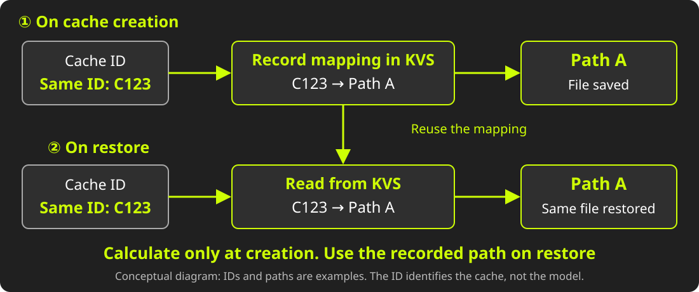</object>
</div>

<!--
【日本語版】
変更以後

【メモ】
- cache作成のタイミングで、ID → cache_pathをRedisに保持
    - 取り出すときは再計算せず、Redisから取得
- シンプルに！
- cache IDはフォームが持つので、提出している本人からは失われない。しかも本人しか知らないIDなので、鍵として安全
- 対応表はあくまでキャッシュなので、1〜2週間ほどで消える。1ヶ月後の再開は対象外（質疑用）
-->

<div class="chapter-label">3. FOCUS ON FILE PATHS</div>

---

# Cache: Result

- Completed at the end of 2025, as our first improvement
- Incidents caused by cache_path dropped to **zero** :tada:
- Next: prevent store_path incidents from recurring

<!--
【日本語版】
cache_path 固定の結果
- 改善第一弾として2025年末に完了
- cache_path起因の障害は **ゼロ** になった
- 次は、store_path側でも再発を防ぐための構造改善
-->

<div class="chapter-label">3. FOCUS ON FILE PATHS</div>

---

# Fix #2: Record store_path

- We could change the identifier format, but chose **a dedicated column**
    - On read, prefer that column; otherwise, calculate as before
    - Backfill existing data by recalculation
- Start with the most problematic Uploader, then expand

<!--
【日本語版】
次の山は store_path の固定
- identifierの形式を変える案もあったが、**専用のカラム** を導入する方針に
    - 読むときはそのカラムを優先、なければ従来どおり計算
    - 既存データはバックフィル。すべて埋まれば、フォールバックを消せる
- 問題の大きいUploaderから始めて、順次広げる
-->

<div class="chapter-label">3. FOCUS ON FILE PATHS</div>

---

# Store: Record the Saved Path

```ruby
class ApplicationUploader < CarrierWave::Uploader::Base
  after :store, :persist_object_store_path

  def persist_object_store_path(*)
    return if should_not_store_full_path?

    persisted_store_path = object_store_path_to_persist
    save_object_store_path(persisted_store_path)
    log_if_mismatch
  end
end
```

- Right after `store`, record the path in the dedicated column

<!--
【日本語版】
実装イメージ: 書き込み側
（コード）
- store の直後に、パスを専用カラムへ記録する

【メモ】
hanicaのコードからポイントを絞り、若干改変したもの。should_not_store_full_path? が write フラグに相当。
-->

<p class="code-note" style="position: absolute; right: 220px; bottom: 96px; margin: 0; font-size: 15px; font-style: italic; color: #bbb;">NOTE: Simplified from the actual code.</p>

<div class="chapter-label">3. FOCUS ON FILE PATHS</div>

---

# Store: Read the Recorded Path

```ruby
class ApplicationUploader < CarrierWave::Uploader::Base
  def store_path(*args)
    calculated_store_path = super(*args)
    persisted_store_path = resolve_persisted_store_path
    log_if_mismatch
    return calculated_store_path if persisted_store_path.nil?
    use_persisted_store_path ? persisted_store_path : calculated_store_path
  end
end
```

- No record? Use the calculated path, as before
- Log any mismatch between the calculated and recorded paths

<!--
【日本語版】
実装イメージ: 読み込み側
（コード）
- 記録がなければ、従来どおり計算したパスを使う
- 計算値と記録値の不一致は、ログで観測する

【メモ】
use_persisted_store_path が read フラグに相当。次の「戻せる設計」へのつなぎ。
-->

<p class="code-note" style="position: absolute; right: 220px; bottom: 96px; margin: 0; font-size: 15px; font-style: italic; color: #bbb;">NOTE: Simplified from the actual code.</p>

<div class="chapter-label">3. FOCUS ON FILE PATHS</div>

---

# Permanent Data Needs a Safe Rollout

- A wrong stored path can outlive the rollout
- Separate **recording paths** from **using recorded paths**
- Verify rollback as well as the forward migration

<div class="chapter-label">3. FOCUS ON FILE PATHS</div>

---

<!-- _class: scrim -->

# Store: Switch Writes, Then Reads

| Step | write | read | Notes |
|---|---|---|---|
| 1 | <span style='color: var(--kor-lime);'>Partly ON</span> | OFF | Double write for some tenants. Reads as before |
| 2 | _All ON_ | OFF | Double write for all tenants. Reads as before |
| 3 | _All ON_ | <span style='color: var(--kor-lime);'>Partly ON</span> | Some tenants read from the fixed paths |
| 4 | _All ON_ | _All ON_ | All tenants read from the fixed paths |

<!--
【日本語版】
write / read の2フェーズフラグ
| ステップ | write | read | 備考 |
| 1 | 一部ON | OFF | 一部テナントでdouble write。参照は従来どおり |
| 2 | _全体ON_ | OFF | 全体でdouble write。参照は従来どおり |
| 3 | _全体ON_ | 一部ON | 一部テナントでdouble writeした固定パスによる参照を開始 |
| 4 | _全体ON_ | _全体ON_ | 全体で固定パスによる参照へ切り替え |
-->

<div class="chapter-label">3. FOCUS ON FILE PATHS</div>

---

# Flipper: Roll Out and Roll Back

- Use **Flipper** to enable write/read flags for selected tenants
- Add a dedicated column alongside the existing identifier
- Include **rollback checks** in QA

<!-- フラグがあるだけで安全とせず、戻した場合の挙動も検証する。 -->

<div class="chapter-label">3. FOCUS ON FILE PATHS</div>

---

# Monitor the Rollout with BigQuery

- Application data was **periodically synced** to BigQuery
- We queried that copy to **monitor the file path rollout**

<style scoped>
pre { min-height: 180px; box-sizing: border-box; }
pre .hljs-comment { color: #c8c8c8; }
</style>

```sql
-- Daily check on the BigQuery copy (simplified)
SELECT id, tenant_id, avatar, avatar_object_path
FROM app_mirror.employee_profiles
WHERE
  -- a file without a path, or a path without a file
  (COALESCE(avatar, '') = '') != (avatar_object_path IS NULL)
  -- or the path does not end with the file name
  OR NOT ENDS_WITH(avatar_object_path, CONCAT('/', avatar))
```

<!-- 定期同期したBigQueryのデータに、毎日クエリを投げて監視した。
実際のクエリ（Redashの「store_path不整合チェック」、毎日22:30実行）を簡略化し、テーブル名・データセット名は伏せたもの。
見ているのは3種類の不整合: ファイルがあるのにパスがない／パスがあるのにファイルがない／パスの末尾がファイル名と一致しない。
実際のクエリでは、調査済みで既知の行を除外している。 -->

<p class="code-note" style="position: absolute; right: 220px; bottom: 96px; margin: 0; font-size: 15px; font-style: italic; color: #bbb;">NOTE: Simplified from the actual code.</p>

<div class="chapter-label">3. FOCUS ON FILE PATHS</div>

---

# QA: Users Should See No Change

- All AI-assisted QA ran in **staging with no customer data**
- Features × preconditions create many test cases
- Define user stories and expected results with AI
- Keep automated tests and check **human-visible evidence**

<!-- _footer: AIを用いたQAはすべて、顧客情報を含まないstaging環境で実施。 -->

<div class="chapter-label">3. FOCUS ON FILE PATHS</div>

---

# QA: Stories Become Evidence

<div style="position: absolute; top: 160px; left: 90px; width: 1100px;">
<object type="image/svg+xml" data="assets/ai-qa-pipeline-en.svg" width="1100" height="460" aria-label="Like compiler passes, each stage passes an artifact to the next: User Story → scenario.yml → result.yml → human-readable report → human review"></object>
</div>

<!--
【日本語版】
Step 2: AIがシナリオにして、実行する

【メモ】
構造化の形式はGherkinなどもあるが、今回は独自形式。
実行役のAIをAIの中で起動。やり取りはファイルとスキーマ。
図は次のStep 3まで含めた全体像。観測と判定を分け、人が最後に証跡をレビューする。
コンパイラのpassのように、各段階が成果物を次へ渡す。
-->

<div class="chapter-label">3. FOCUS ON FILE PATHS</div>

---

# QA: Results and Human Review

- About **30 large stories**, checked in **2 days by about 3 people**
- Screenshots, logs, verdicts, and reasons are reviewed in PRs
- Existing tests are kept; automated coverage is strengthened
- The value: **more cases checked**, with a human final review

<div class="chapter-label">3. FOCUS ON FILE PATHS</div>

---

# Store: Current Status

- Some images have **fully switched** to fixed paths
- We will expand to all images, step by step, the same way

<!--
【日本語版】
store_path 固定の現在地
- 一部の画像では、固定パスへ **完全に切り替わった**
- 同じ手法で、少しずつ全画像に広げていく
-->

<div class="chapter-label">3. FOCUS ON FILE PATHS</div>

---

# File Paths: What Matters

- **Record a stable reference** to each saved file
- Separate writes and reads to make the rollout controllable
- **Test the way back**, not only the way forward

<div class="chapter-label">3. FOCUS ON FILE PATHS</div>

<!-- _footer: まとめ: 壊れやすいパスを1:1で引けるよう固定した。<br>大きな変更は必ず戻せるように、AI駆動QAで品質を担保。 -->

---

<!-- _class: section -->

# 4. Focus on History

<div class="chapter-label">4. FOCUS ON HISTORY</div>

---

# Making Images and History Work

- Employee history is essential to our service
- Handling images is essential too
- Combining them requires **extra care**

<!-- 従業員の履歴情報も画像も重要。両方を組み合わせると、ファイルのライフサイクルに注意が必要。 -->

<div class="chapter-label">4. FOCUS ON HISTORY</div>

---

# Bitemporal Data Model and Us

<div style="position: absolute; top: 150px; left: 180px; width: 920px;">
<object type="image/svg+xml" data="assets/bitemporal-history-en.svg" width="920" height="385" aria-label="Valid time runs left to right and transaction time runs top to bottom. On 10/17, the location since 10/1 is corrected; the old row is kept and two rows, Tokyo and Hakata, are added."></object>
</div>

<!-- _footer: See also "[履歴 on Rails](https://kaigionrails.org/2025/talks/hypermkt/)" (KoR 2025) -->

<!--
【日本語版】
バイテンポラルデータモデル

【メモ】
日付は説明用。期間は開始を含み終了を含まない [from, to)。
行Aのtransaction_toを更新時刻で閉じ、行B・Cを追加する。旧行を削除して2行にするわけではない。
参考: https://github.com/kufu/activerecord-bitemporal
-->

<div class="chapter-label">4. FOCUS ON HISTORY</div>

---

# History Copying Has Side Effects

<div style="position: absolute; top: 175px; left: 90px; width: 1100px;">
<object type="image/svg+xml" data="assets/history-copy-upload-en.svg" width="1100" height="390" aria-label="Copy history: previous row to new row → internal assign → upload via cache!"></object>
</div>

<p style="position: absolute; top: 575px; left: 90px; width: 1100px; text-align: center;">Our history-copy workflow + CarrierWave's assignment behavior<br>can <strong>upload the same file again.</strong></p>

<!--
【日本語版】
バイテンポラルとファイルの困り事
- 履歴分割のたびに、同じファイルを持つ行が複製される
    - 実装的には「前の履歴」の値コピー
    - ところがCarrierWaveは、**値を代入しただけでアップロード（`cache!`）が走る**
    - 見えない副作用として、不要なアップロードが走ってしまう
-->

<div class="chapter-label">4. FOCUS ON HISTORY</div>

---

# The Fix: Mark History Copies

<div style="position: absolute; top: 165px; left: 90px; width: 1100px;">
<object type="image/svg+xml" data="assets/history-copy-skip-upload-en.svg" width="1100" height="390" aria-label="The fix: copy the history row and assign internally, but skip the upload when bitemporal operations are marked as in progress."></object>
</div>

<p style="position: absolute; top: 560px; left: 90px; right: 90px; text-align: center;"><strong>In the PR:</strong> <code>CurrentAttributes</code> carries<br>the “copy in progress” state into hooks.</p>

<!--
【日本語版】
もう一つの性能改善: 再アップロードを防ぐ
- 履歴を複製するときに **「履歴複製中」のマーク** を付ける
    - その間はアップロードを回避し、同じファイルを再アップロードしない
- フック内部へ状態を伝えるため、`CurrentAttributes` を使う
- 本番投入間近のPRとして実装済み
-->

<div class="chapter-label">4. FOCUS ON HISTORY</div>

---

# CurrentAttributes: Into the Hook

<style scoped>
.code-cols { display: grid; grid-template-columns: minmax(0, 1fr) minmax(0, 1fr); gap: 28px; margin-top: 8px; width: 1060px; }
.code-cols h2 { text-align: left; color: var(--kor-pink); font-size: 26px; margin: 0 0 10px; }
.code-cols pre { font-size: 17px; margin: 0; box-sizing: border-box; height: 330px; }
pre .hljs-comment { color: #c8c8c8; }
</style>

<div class="code-cols">
<div>

## 1. Mark the scope

```ruby
# Per-request state, reset by Rails
class HistoryCopy < AS::CurrentAttributes
  attribute :in_progress, default: false
end

# In ApplicationUploader
def self.copying_history
  HistoryCopy.in_progress = true
  yield
ensure # reset, even on errors
  HistoryCopy.in_progress = false
end
```

</div>
<div>

## 2. Skip the upload in the hook

```ruby
# In ApplicationUploader
# Assignment runs cache!; skip it during copy
def cache!(*)
  return if HistoryCopy.in_progress

  super
end

# Usage
ApplicationUploader.copying_history do
  record.copy_history!
end
```

</div>
</div>

<!-- 簡略化した模擬コード。既存の VersionCacheSuppressible（承認処理中だけ version 生成を止める仕組み）と同じ形で、
CurrentAttributes でスコープを示し、CarrierWave のフック（cache!）を上書きして抑止し、ensure で必ず解除する。
リリース間近の実際のPRは別の形（同じリクエスト内で同じ store path への2回目の保存を省く）で、細部は異なる。 -->

<p class="code-note" style="position: absolute; right: 220px; bottom: 96px; margin: 0; font-size: 15px; font-style: italic; color: #bbb;">NOTE: Simplified from the actual code.</p>

<div class="chapter-label">4. FOCUS ON HISTORY</div>

---

# History: Measuring the Upcoming PR

<div style="position: absolute; top: 160px; left: 90px; width: 1100px;">
<object type="image/svg+xml" data="assets/bench-history-copy-en.svg" width="1100" height="460" aria-label="Before: 17.0 seconds and 39 GCS calls. With duplicate-upload suppression: 9.6 seconds and 22 GCS calls. put, delete, and copy each drop from 11 to 6.">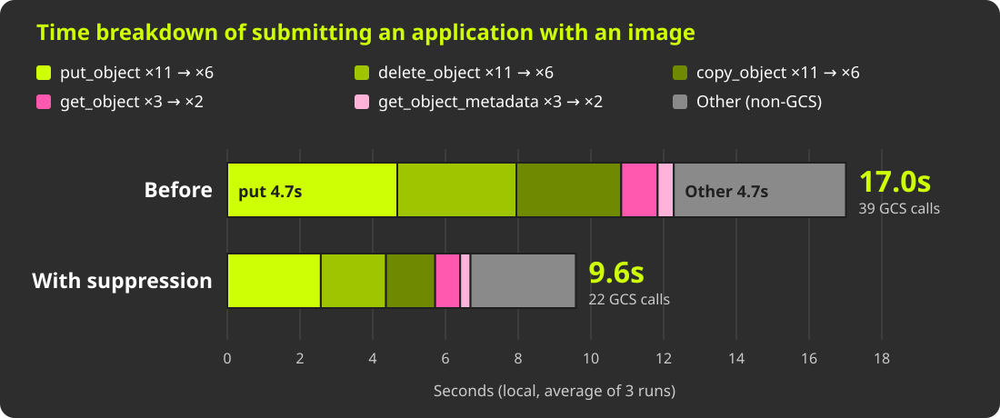</object>
</div>

<p style="position: absolute; top: 622px; left: 90px; right: 90px; text-align: center; font-size: 21px;">Local run of a <strong>near-release PR</strong>: <strong>17.0s → 9.6s (−44%)</strong> · GCS calls <strong>39 → 22</strong></p>

<!--
履歴分割時の重複アップロードを抑止する変更は、もうすぐ本番環境に入れられる状態のPRになっている。そのPRを最新のstagingにリベースし、ローカルで計測した。
操作: 実画面から「アバターいますぐ」（承認なし）の申請を提出し、既存のプロフィール画像を差し替える（申請提出 create_by_applicant）。
抑止なし／ありを交互に3回ずつ、毎回別の画像で実行した平均。
全体 17.0秒 → 9.6秒（−44%）。GCS操作 39回 → 22回。put / delete / copy がそれぞれ 11回 → 6回、get / metadata が 3回 → 2回。
1回あたりのレイテンシ（put 約430ms、delete 約300ms、copy 約225〜260ms）は前後で同じなので、短縮分は回数の削減によるもの。
対策後もGCSが全体の約70%を占める。
5章のPoC（設計・調査段階）とは違い、こちらはリリース直前のPR。ただしローカルでの計測であり、本番での効果や展開完了を示すものではない。
コピーした履歴が、期待どおりの画像を参照し続けていることも確認済み。
-->

<div class="chapter-label">4. FOCUS ON HISTORY</div>

---

# History: What Matters

- Make the difference between **copying a reference** and **uploading a file** explicit
- Keep lifecycle side effects under application control
- Validate the history behavior before rolling out
- The PR is nearly ready; **the production rollout is next**

<div class="chapter-label">4. FOCUS ON HISTORY</div>

<!-- _footer: まとめ: 履歴実装＋画像で不要なアップロードが起こった。<br>CurrentAttributesで内部フックを制御。PRは本番投入間近。 -->

---

<!-- _class: section -->

# 5. Reducing Coupling

<div class="chapter-label">5. REDUCING COUPLING</div>

---

# :warning: Status: Design and Investigation

<!-- _class: scrim -->

- The approaches in this chapter are **still being designed and investigated**.
- The diagrams show **intended boundaries**, not a completed architecture.
- The performance result comes from a **local PoC**, not production.

<!-- _footer: 疎結合化のための施策は、設計・調査段階の内容になります。 -->

<!--
【日本語版】
この章で紹介する施策は、設計・調査段階にある。
図は目指す責務の境界を示すもので、実装済みの構成ではない。
後述のパフォーマンス計測はローカルPoCによるもので、本番の結果ではない。
-->

<div class="chapter-label">5. REDUCING COUPLING</div>

---

# Current: Coupled Image Responsibilities

<div style="position: absolute; top: 160px; left: 90px; width: 1100px;">
<object type="image/svg+xml" data="assets/upload-coupling-en.svg" width="1100" height="460" aria-label="Inside the application, CarrierWave callbacks connect business logic, internal API calls, file path logic, image resizing, and EXIF removal."></object>
</div>

<!-- 現状の責務の絡まりを概念的に表した図。厳密な実行順やデータフローではない。 -->

<div class="chapter-label">5. REDUCING COUPLING</div>

---

# A Simpler, Decoupled Design

<div style="position: absolute; top: 160px; left: 90px; width: 1100px;">
<object type="image/svg+xml" data="assets/upload-architecture-en.svg" width="1100" height="460" aria-label="The app branches in two directions. Processing that depends on CarrierWave's internals goes into the compatibility layer, and image processing that does not depend on it goes to an external service."></object>
</div>

<!--
【日本語版】
複雑性の削減のために目指す姿

【メモ】
計画段階の責務・依存関係の図。矢印は画像データの転送経路ではない。
Uploaderの仕事を「決まったパスにバイト列を置く」ことへ絞り、画像処理を分離する。
-->

<div class="chapter-label">5. REDUCING COUPLING</div>

---

# Image Operations: Find the Boundary

<style scoped>
.comparison { display: grid; grid-template-columns: 1fr 1fr; gap: 36px; }
.comparison h2 { text-align: left; color: var(--kor-pink); margin-bottom: 16px; }
.comparison pre { height: 140px; box-sizing: border-box; font-size: 23px; display: flex; align-items: center; }
.comparison p { font-size: 25px; }
.comparison-summary { margin-top: 18px; }
</style>

Nearly **300 call sites** depend on CarrierWave.

<div class="comparison">
<div>

## Before: Uploader behavior

```ruby
user.avatar.present?
```

Depends on the Uploader's `blank?`

</div>
<div>

## After: Application intent

```ruby
CarrierWaveCompatLayer.attached?(
  user, :avatar
)
```

Ask whether a file is attached

</div>
</div>

<p class="comparison-summary"><strong>Same behavior, an explicit boundary.</strong><br>Migrate callers incrementally; extraction is under analysis.</p>

<!--
既存資料の互換レイヤのコード例を再掲。Before / After は呼び出し側の比較。
present? が依存するUploaderのblank?の挙動を、互換レイヤ内部で維持する。
新しいAPI名だけでストレージ上のファイル実在確認を行うという意味ではない。
-->

<div class="chapter-label">5. REDUCING COUPLING</div>

---

# Image Operations: Wrap the API

<div style="position: absolute; top: 160px; left: 90px; width: 1100px;">
<object type="image/svg+xml" data="assets/compatibility-layer-en.svg" width="1100" height="460" aria-label="SmartHR calls the wrapped image operation API to get a name, get image size, and perform other operations. The CarrierWave API stays inside the wrapper."></object>
</div>

<!-- SmartHRが必要とする画像操作を互換レイヤで公開し、CarrierWave固有のAPIを内側に閉じ込める。 -->

<div class="chapter-label">5. REDUCING COUPLING</div>

---

# Preprocessing: The Current Cost

<div style="position: absolute; top: 170px; left: 90px; width: 1100px;">
<object type="image/svg+xml" data="assets/preprocessing-sync-en.svg" width="1100" height="360" aria-label="File → SmartHR Uploader → large, small, and thumbnail images in GCS. All resizing and uploads run synchronously."></object>
</div>

<p style="position: absolute; top: 555px; left: 90px; right: 90px; text-align: center;">Resizing, EXIF handling, and uploads — <strong>all before saving finishes.</strong></p>

<!--
【日本語版】
画像の「前処理」が非常に多い
- 表示用途に合わせたサイズ違い画像（`version`）の生成
- EXIFの向き情報に基づく回転
- EXIF情報（住所など）の除去
    - これらがアップロード時に**同期で**走り、保存完了までの待ち時間になる
-->

<div class="chapter-label">5. REDUCING COUPLING</div>

---

# Preprocessing: Move It Out

<div style="position: absolute; top: 170px; left: 90px; width: 1100px;">
<object type="image/svg+xml" data="assets/preprocessing-ondemand-en.svg" width="1100" height="360" aria-label="Upload only the original to GCS. A dynamic resizer reads it and generates images on demand; a CDN caches and delivers them to the browser.">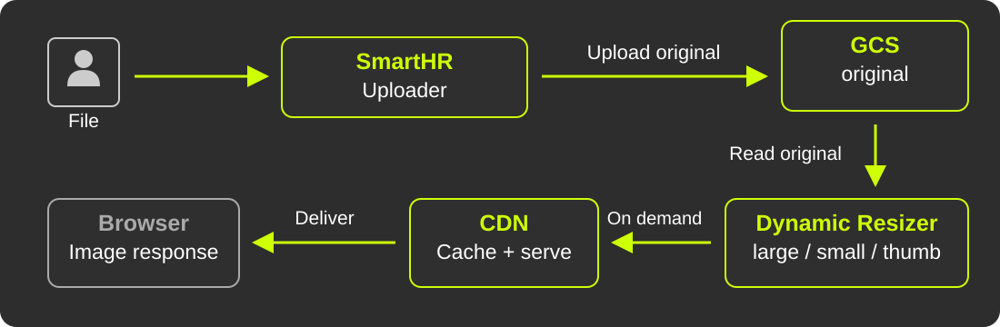</object>
</div>

<p style="position: absolute; top: 535px; left: 90px; right: 90px; text-align: center; font-size: 25px;"><strong>Preserve required processing, including location metadata removal.</strong><br>PoC: on-demand image service + CDN<br>Examples: <a href="https://www.slideshare.net/slideshow/20111102-rails-meetuptofu/10084092">Cookpad's tofu</a> · <a href="https://imageflux.sakura.ad.jp/">ImageFlux</a></p>

<!--
【日本語版】
同期処理を切り出したい
- サイズ違い画像は、別サービスでオンデマンドに生成するとどうか？
- 位置情報の除去など、必要な画像処理を維持することが前提
- 同期処理から何を切り出すかを検討する。EXIF処理を必ず外部へ移すとは限らない
- 別サービスの内容はCDNに載せキャッシュすれば、負荷の懸念も小さい
- 画像変換サービス + CDN という構成は、実サービスでも多く採られている
    - Cookpad の [tofu](https://www.slideshare.net/slideshow/20111102-rails-meetuptofu/10084092) を始め、色々
    - [ImageFlux](https://imageflux.sakura.ad.jp/) 等専用サービスも

【質疑用】
EXIF処理の計測上の影響は相対的に小さい。既存の実行箇所に維持する可能性もあり、切り出す範囲は検討中。
-->

<div class="chapter-label">5. REDUCING COUPLING</div>

---

# A Side Benefit: Better Performance

<div style="position: absolute; top: 160px; left: 90px; width: 1100px;">
<object type="image/svg+xml" data="assets/bench-preprocess-local-en.svg" width="1100" height="460" aria-label="Local measurement, average of three runs: with preprocessing 17.9 seconds; without it 5.8 seconds. Fewer resized images also meant fewer GCS uploads.">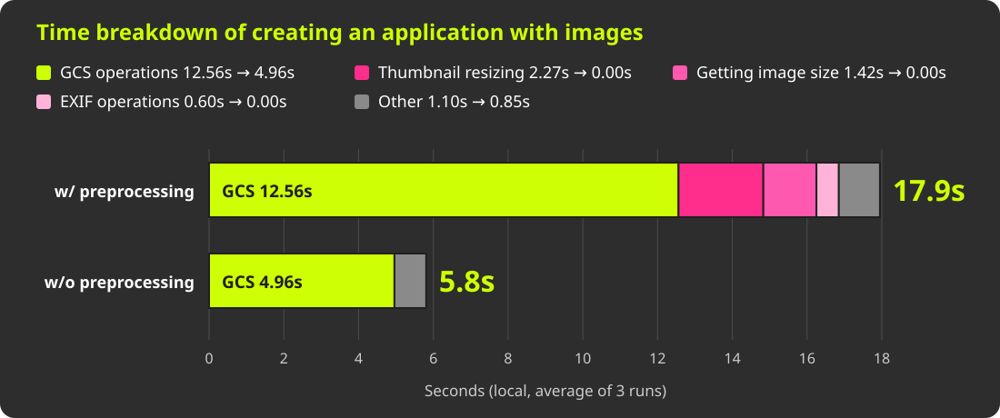</object>
</div>

<p style="position: absolute; top: 622px; left: 90px; right: 90px; text-align: center; font-size: 21px;">Local PoC: <strong>17.9s → 5.8s</strong> · fewer resized images meant fewer GCS uploads</p>

<!--
おまけとしてローカル計測を紹介。申請者による作成処理（create_by_applicant）、3回の平均。
前処理あり17.9秒、なし5.8秒。GCSの往復回数も39→15回。
サイズ違い画像の生成と追加アップロードをやめたため、GCS処理も減るのは自然な結果。
本番の所要時間や改善幅を直接示すものではない。
-->

<div class="chapter-label">5. REDUCING COUPLING</div>

---

<!-- _footer: まとめ: 複雑な仕様をレイヤ導入＋分析で疎結合にしたい。<br>パフォーマンスにも効いてくる。 -->

# Clearer Boundaries, Less Work

- **Analyze** which behaviors the application needs to preserve.
- **Isolate** CarrierWave-specific operations and image processing behind clear boundaries.
- **Reduce synchronous work** in the upload path; the local PoC suggests a performance benefit.

<!--
【日本語版】
複雑な仕様を分析し、必要な振る舞いを明確にする。
CarrierWave固有の操作と画像処理を切り出し、責務の境界を作る。
同期処理の削減はローカルPoCで速度にも効果が見えたが、本番での効果は未確認。
この整理を踏まえて、次章ではCarrierWaveを更新するか置き換えるかを考える。
-->

<div class="chapter-label">5. REDUCING COUPLING</div>

---

<!-- _class: section -->

# 6. Upgrade or Replace?

<div class="chapter-label">6. UPGRADE OR REPLACE?</div>

---

# What Could Replace CarrierWave?

<div style="position: absolute; top: 160px; left: 90px; width: 1100px;">
<object type="image/svg+xml" data="assets/replacement-options-en.svg" width="1100" height="460" aria-label="Three possible replacements: ActiveStorage, Shrine, or an in-house solution. Continuing to upgrade CarrierWave is also an option.">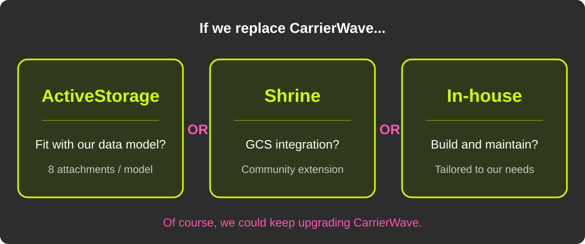</object>
</div>

<!-- 元の3案を同じ重みで示す。CarrierWaveを更新して使い続ける選択肢も残る。候補の採否は未決定。 -->

<div class="chapter-label">6. UPGRADE OR REPLACE?</div>

---

# No Decision Yet

- Upgrading CarrierWave and replacing it are both options
- Catching up to a newer version may be the practical next step
- First, **simplify the behavior we must preserve**
- Keep application needs separate from library internals

<div class="chapter-label">6. UPGRADE OR REPLACE?</div>

---

<!-- _class: section-plain -->

# Whatever the Choice,<br><span style="color: var(--kor-pink);">Make Responsibilities Clear.</span>

<!-- 更新か置き換えかは未決定。どちらでも、何をアプリ・ライブラリ・外部サービスが担うかを明確にする。 -->

<!-- _footer: 結論はまだ出ていないが、更新にせよ、移行にせよ、<br>ファイルアップロードの責務と影響範囲を明確にすることが重要。 -->


<div class="chapter-label">6. UPGRADE OR REPLACE?</div>

---

<!-- _class: section -->

# 7. Takeaways

<div class="chapter-label">7. TAKEAWAYS</div>

---

<!-- _class: section-plain -->

# First, split the problem<br>by quality attribute.

<!-- _footer: まず、課題を性質で分割する。 -->

<div class="chapter-label">7. TAKEAWAYS</div>

---

<!-- _class: section-plain -->

# Make important changes<br>reversible.

<!-- _footer: 重要な変更は、必ず戻せるようにする。 -->

<div class="chapter-label">7. TAKEAWAYS</div>

---

<!-- _class: section-plain -->

# Watch for hidden bugs<br>where behaviors interact.

<!-- _footer: 仕様の組み合わせによる、暗黙のバグに注意する。 -->

<div class="chapter-label">7. TAKEAWAYS</div>

---

<!-- _class: section-plain -->

<style scoped>
h1 { top: 44%; }
</style>

# Extract image complexity<br>step by step.<br><span style="font-size: 44px; color: var(--kor-pink);">For upgrades or replacement.</span>

<!-- _footer: 画像の複雑な仕様を、少しずつ切り出す。<br>最終的な更新でも移行でも、その整理が必要になる。 -->

<div class="chapter-label">7. TAKEAWAYS</div>

---

<!-- _class: quote -->

<!-- _footer: 参考訳: あなたが本当に整備しているのは“あなた自身”という名のオートバイだ。 -->

<style scoped>
h1 { top: 220px; font-size: 60px; line-height: 1.15; }
</style>

# “The real cycle you’re working on<br>is a cycle called <strong>yourself.</strong>”

## Robert M. Pirsig, <i>Zen and the Art of Motorcycle Maintenance</i>

<!--
【日本語版】
“The real cycle you’re working on is a cycle called yourself.”
Robert M. Pirsig, Zen and the Art of Motorcycle Maintenance

【メモ】
試訳: あなたが本当に整備しているのは、「あなた自身」という名のオートバイだ。
技術的負債や課題に向き合うことは、自分自身の成長やエンジニアリングの姿勢に向き合うことでもある、と回収する。
-->

<div class="chapter-label">7. TAKEAWAYS</div>

---

<!-- _class: section-plain -->

# Face your problems.<br>Make you and your users happy.

<!--
【日本語版】
課題に向き合って、 自分もユーザーもハッピーに
-->

<div class="chapter-label">7. TAKEAWAYS</div>

---

<!-- _class: title -->
<!-- _paginate: false -->

<style scoped>
h1 { top: 80px; }
h2 { top: 460px; }
</style>

# Thank you!

<a href="https://udzura.jp/slides/2026/kaigionrails" style="position: absolute; top: 200px; left: 532px; display: block; width: 216px; height: 216px;">

</a>

## [udzura.jp/slides/2026/kaigionrails](https://udzura.jp/slides/2026/kaigionrails)

<!--
【日本語版】
Thank you!
[udzura.jp/slides/2026/kaigionrails](https://udzura.jp/slides/2026/kaigionrails)
-->

<!-- _footer: Thanks: Team members! @eminem, @a5-stable, @yudai -->

---

<!-- _class: full -->
<!-- _paginate: false -->

<style scoped>
img { object-fit: contain; }
</style>


